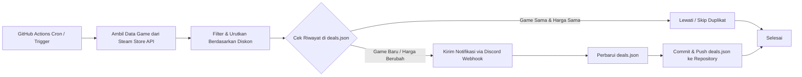

# Steam Deals Discord Notification 🎮🔥

[](https://nodejs.org/)
[](https://vitest.dev/)
[](https://github.com/features/actions)
[](LICENSE)

Aplikasi otomatisasi untuk memantau game Steam yang sedang diskon dan mengirimkan notifikasi ke channel Discord melalui Discord Webhook. Sistem ini berjalan secara terjadwal dan mandiri menggunakan **GitHub Actions**, sehingga **100% gratis tanpa perlu VPS, server cloud pribadi, atau proses Node.js yang berjalan terus-menerus selama 24 jam**.

---

## Daftar Isi
- [Gambaran Umum & Alur Kerja](#gambaran-umum--alur-kerja)
- [Fitur Utama](#fitur-utama)
- [Teknologi yang Digunakan](#teknologi-yang-digunakan)
- [Struktur Direktori](#struktur-direktori)
- [Persyaratan Sistem](#persyaratan-sistem)
- [Panduan Instalasi & Menjalankan Lokal](#panduan-instalasi--menjalankan-lokal)
- [Cara Membuat Discord Webhook](#cara-membuat-discord-webhook)
- [Konfigurasi Environment Variables](#konfigurasi-environment-variables)
- [Panduan Deployment ke GitHub Actions](#panduan-deployment-ke-github-actions)
  - [1. Membuat Repository GitHub](#1-membuat-repository-github)
  - [2. Mengatur GitHub Secrets & Variables](#2-mengatur-github-secrets--variables)
  - [3. Mengaktifkan & Menguji GitHub Actions](#3-mengaktifkan--menguji-github-actions)
- [Cara Mengubah Jadwal Cron](#cara-mengubah-jadwal-cron)
- [Cara Mengubah Filter Diskon & Harga](#cara-mengubah-filter-diskon--harga)
- [Cara Kerja Sistem Anti-Duplikasi](#cara-kerja-sistem-anti-duplikasi)
- [Keterbatasan API Steam](#keterbatasan-api-steam)
- [Pengujian Otomatis (Testing)](#pengujian-otomatis-testing)
- [Troubleshooting & Solusi Kendala](#troubleshooting--solusi-kendala)
- [Lisensi](#lisensi)

---

## Gambaran Umum & Alur Kerja



1. **Jadwal Otomatis**: GitHub Actions memicu workflow setiap 3 jam (atau manual via `workflow_dispatch`).
2. **Pengambilan Data**: Mengambil data game diskon dari Steam Store API dengan regional Indonesia (`cc=ID`, `l=indonesian`, mata uang IDR).
3. **Filter & Sort**: Memfilter game berdasarkan kriteria minimal diskon, batas harga maksimal, game gratis, serta mengurutkan dari diskon tertinggi.
4. **Anti-Duplikasi**: Memeriksa file riwayat `src/storage/deals.json`. Game yang sudah pernah dikirim tidak akan dikirim ulang kecuali terdapat perubahan harga atau diskon.
5. **Notifikasi Discord**: Mengirim kartu **Discord Embed** informatif yang memuat poster game, persentase diskon, harga normal (dicoret), harga diskon tebal, dan tautan langsung ke Steam Store.
6. **Penyimpanan State**: GitHub Actions melakukan commit dan push otomatis terhadap file `deals.json` kembali ke repository tanpa memicu infinite loop build (`[skip ci]`).

---

## Fitur Utama

- 🇮🇩 **Regional Khusus Indonesia**: Mengambil harga lokal Steam Indonesia (Rupiah) dengan format resmi `RpXXX.XXX`.
- 🔍 **Filter Fleksibel**:
  - `MIN_DISCOUNT`: Persentase minimal potongan harga (misal: hanya game diskon >= 50%).
  - `MAX_PRICE`: Batas harga maksimal dalam Rupiah (misal: hanya game di bawah Rp100.000).
  - `MAX_GAMES`: Membatasi jumlah game per pengiriman agar tidak membanjiri channel.
  - `INCLUDE_FREE_GAMES`: Opsi menyertakan atau mengecualikan game gratis / diskon 100%.
- 🛡️ **Deteksi Duplikasi Cerdas**:
  - Mencegah pengiriman game yang sama berulang kali.
  - Otomatis mendeteksi jika game yang sama mengalami diskon lebih besar atau perubahan harga.
  - Perlindungan terhadap file riwayat rusak (*auto-recovery & backup*).
- 💬 **Tampilan Discord Embed Profesional**:
  - Banner gambar game berkualitas tinggi (460x215).
  - Harga normal dicoret (`~~Rp699.999~~`) dan harga promo ditonjolkan (`**Rp349.999**`).
  - Tautan langsung `[LIHAT DI STEAM]`.
  - Dilengkapi *allowed_mentions* kosong agar bot tidak menimbulkan mention `@everyone` atau `@here` yang mengganggu.
- ⏱️ **Ketahanan Terhadap Rate Limit & Kegagalan**:
  - Mendeteksi respon HTTP 429 dari Discord dan otomatis menunggu sesuai header `retry_after`.
  - Mekanisme *retry* dengan *exponential backoff* untuk kegagalan jaringan atau server.
  - Jeda waktu aman (*rate pacing*) antar pengiriman pesan.
- 🔒 **Keamanan Ketat**:
  - URL Webhook dan token rahasia otomatis disanitasi (*masked*) sehingga tidak akan pernah bocor ke terminal, artifact, atau log publik GitHub Actions.
- 🧪 **Pengujian Menyeluruh (Vitest)**:
  - 47+ automated unit tests dengan mocking API eksternal dan cakupan kode > 85%.

---

## Teknologi yang Digunakan

| Komponen | Teknologi | Keterangan |
| :--- | :--- | :--- |
| **Runtime** | Node.js 24 (LTS) | Menggunakan JavaScript ES Modules (`"type": "module"`) |
| **Package Manager** | npm | Pengelolaan dependensi |
| **Sumber Data** | Steam Store API | Endpoint publik `featuredcategories` & `featured` |
| **Notifikasi** | Discord Webhook API | Format REST JSON dengan Discord Embeds |
| **Otomatisasi** | GitHub Actions | Penjadwalan Cron serverless & workflow dispatch |
| **Penyimpanan State** | JSON Flat File | `src/storage/deals.json` |
| **Testing** | Vitest 3+ | Framework pengujian cepat dengan V8 coverage |
| **Environment** | dotenv | Konfigurasi variabel lingkungan untuk lokal |

---

## Struktur Direktori

```
steam-deals-discord/
├── .github/
│   └── workflows/
│       └── steam-deals.yml       # Definisi workflow otomatis GitHub Actions
├── src/
│   ├── config/
│   │   └── index.js              # Parsing, validasi, dan default environment variables
│   ├── services/
│   │   ├── steam.service.js      # Pengambilan & normalisasi data Steam Store
│   │   ├── discord.service.js    # Embed builder, pengiriman webhook & rate-limit handler
│   │   └── storage.service.js    # Logika anti-duplikasi & persistensi riwayat
│   ├── utils/
│   │   ├── filters.js            # Algoritma filter harga, diskon, & sorting
│   │   ├── formatter.js          # Format Rupiah, persentase, & Discord color parser
│   │   └── logger.js             # Logging terstruktur dengan masking URL webhook
│   ├── storage/
│   │   ├── deals.json            # Database riwayat notifikasi (JSON)
│   │   └── index.js              # Re-export storage service
│   └── index.js                  # Entry point utama aplikasi
├── tests/
│   ├── steam.test.js             # Pengujian pengambilan & normalisasi Steam
│   ├── filters.test.js           # Pengujian filter diskon, harga, format Rupiah
│   ├── discord.test.js           # Pengujian embed Discord, retry, & rate-limit
│   ├── storage.test.js           # Pengujian deteksi duplikat & recovery file rusak
│   └── index.test.js             # Pengujian orkestrasi end-to-end
├── .env.example                  # Template konfigurasi environment variables
├── .gitignore                    # Mengabaikan node_modules, .env, dll.
├── package.json                  # Konfigurasi dependensi dan script npm
└── README.md                     # Dokumentasi lengkap berbahasa Indonesia
```

---

## Persyaratan Sistem

- Komputer lokal dengan **Node.js versi 20+** (disarankan Node.js 24 LTS).
- Akun **Discord** dan server Discord dengan izin mengelola Webhook.
- Akun **GitHub** untuk hosting repository dan menjalankan GitHub Actions.

---

## Panduan Instalasi & Menjalankan Lokal

### 1. Clone atau Buka Direktori Project
```bash
cd e:/Code/steam-deals-discord
```

### 2. Install Dependensi
```bash
npm install
```

### 3. Siapkan File Konfigurasi `.env`
Salin template konfigurasi:
```bash
# Windows PowerShell:
Copy-Item .env.example .env

# Bash / Linux / macOS:
cp .env.example .env
```
Buka file `.env` dan masukkan URL Webhook Discord Anda (lihat petunjuk di bawah jika belum memilikinya).

### 4. Jalankan Aplikasi
Tersedia dua mode eksekusi:

#### Mode Simulasi (Dry Run)
Berguna untuk memeriksa data yang diambil dan hasil filter tanpa mengirim pesan ke Discord:
```bash
npm start -- --dry-run
```
*(Catatan: Jika `DISCORD_WEBHOOK_URL` belum diisi di `.env`, aplikasi otomatis berjalan dalam mode DRY RUN).*

#### Mode Live (Kirim ke Discord)
Setelah `DISCORD_WEBHOOK_URL` diisi pada `.env`:
```bash
npm start
```

---

## Cara Membuat Discord Webhook

1. Buka aplikasi **Discord** di desktop atau browser.
2. Masuk ke **Server Discord** milik Anda (atau server tempat Anda memiliki izin Admin/Manage Webhooks).
3. Pilih channel teks yang ingin digunakan untuk menerima promo game (misal: `#steam-deals`).
4. Klik ikon gerigi ⚙️ (**Edit Channel**) di sebelah nama channel.
5. Klik menu **Integrations** di bilah sisi kiri.
6. Klik tombol **Webhooks** atau **Create Webhook** / **New Webhook**.
7. Berikan nama bot, misalnya: `Steam Deals Bot`.
8. Klik tombol **Copy Webhook URL**.
9. Simpan URL ini untuk dimasukkan ke file `.env` lokal atau GitHub Secrets.

> ⚠️ **PENTING**: Jangan pernah membagikan atau mem-push URL Webhook ini ke repository publik! Siapa pun yang memiliki URL tersebut dapat mengirim pesan ke channel Discord Anda.

---

## Konfigurasi Environment Variables

Aplikasi mendukung konfigurasi berikut melalui `.env` (lokal) atau GitHub Secrets / Variables (production):

| Variabel | Wajib? | Nilai Default | Keterangan |
| :--- | :---: | :--- | :--- |
| `DISCORD_WEBHOOK_URL` | **Ya** (Live) | *(Kosong)* | URL Discord Webhook lengkap |
| `MIN_DISCOUNT` | Tidak | `50` | Minimal diskon game dalam persen (1 - 100) |
| `MAX_PRICE` | Tidak | `100000` | Batas harga maksimal setelah diskon dalam IDR (`0` = tanpa batas) |
| `MAX_GAMES` | Tidak | `10` | Jumlah maksimal game yang dikirim dalam satu eksekusi |
| `INCLUDE_FREE_GAMES`| Tidak | `false` | `true` untuk menyertakan game gratis (diskon 100%), `false` untuk mengabaikan |
| `DISCORD_USERNAME` | Tidak | `Steam Deals Alert` | Nama pengirim bot di Discord |
| `DISCORD_AVATAR_URL`| Tidak | Logo Steam resmi | URL icon profil bot Discord |
| `DISCORD_EMBED_COLOR`| Tidak| `#1B2838` | Warna garis samping embed (Hex `#RRGGBB` atau angka) |
| `STEAM_COUNTRY_CODE`| Tidak | `ID` | Kode negara regional Steam (`ID` untuk Indonesia) |
| `STEAM_LANGUAGE` | Tidak | `indonesian` | Bahasa respon Steam |
| `REQUEST_TIMEOUT_MS`| Tidak | `10000` | Batas waktu tunggu request HTTP dalam milidetik (10 detik) |
| `DEALS_STORAGE_PATH`| Tidak | `src/storage/deals.json` | Path file penyimpanan riwayat notifikasi |

---

## Panduan Deployment ke GitHub Actions

Ikuti langkah mudah ini untuk membuat bot berjalan otomatis di GitHub tanpa server:

### 1. Membuat Repository GitHub
1. Buka [GitHub New Repository](https://github.com/new).
2. Beri nama repository, misalnya: `steam-deals-discord`.
3. Pilih **Public** atau **Private** sesuai preferensi Anda.
4. Klik **Create repository**.
5. Buka terminal pada folder project Anda dan inisialisasi Git:
   ```bash
   git init
   git add .
   git commit -m "feat: initial commit steam deals discord notification"
   git branch -M main
   git remote add origin https://github.com/<username-anda>/steam-deals-discord.git
   git push -u origin main
   ```

### 2. Mengatur GitHub Secrets & Variables
Agar workflow dapat mengirim pesan ke Discord, daftarkan Webhook URL di Secrets:

1. Di halaman repository GitHub Anda, buka tab **Settings**.
2. Di menu sebelah kiri, pilih **Secrets and variables** > **Actions**.
3. Di bagian **Repository secrets**, klik **New repository secret**:
   - **Name**: `DISCORD_WEBHOOK_URL`
   - **Secret**: Masukkan URL Webhook Discord Anda (contoh: `https://discord.com/api/webhooks/123456789/xyz...`)
   - Klik **Add secret**.
4. *(Opsional)* Jika ingin mengubah filter tanpa mengubah kode, Anda dapat menambahkannya di tab **Variables** (misal `MIN_DISCOUNT=60` atau `MAX_PRICE=150000`).

### 3. Mengaktifkan & Menguji GitHub Actions
1. Buka tab **Actions** di repository GitHub Anda.
2. Di menu sebelah kiri, Anda akan melihat workflow **Steam Deals Discord Notification**.
3. Klik tombol **Run workflow** di sebelah kanan:
   - Pilih branch `main`.
   - Opsi `Simulate without posting to Discord`: Biarkan tidak tercentang untuk mengirim langsung, atau centang jika ingin uji coba (*dry run*).
   - Klik tombol hijau **Run workflow**.
4. Tunggu beberapa detik hingga proses selesai bertanda centang hijau ✅.
5. Periksa channel Discord Anda; notifikasi game diskon akan langsung muncul!

---

## Cara Mengubah Jadwal Cron

Jadwal otomatisasi diatur di file `.github/workflows/steam-deals.yml` pada baris:

```yaml
on:
  schedule:
    - cron: '0 */3 * * *' # Setiap 3 jam sekali
```

Format standar cron: `menit jam tanggal bulan hari-dalam-seminggu` (menggunakan zona waktu UTC).

Contoh jadwal populer lainnya:
- Setiap 1 jam: `- cron: '0 * * * *'`
- Setiap 6 jam: `- cron: '0 */6 * * *'`
- Setiap 12 jam: `- cron: '0 */12 * * *'`
- Sekali sehari jam 19.00 WIB (12.00 UTC): `- cron: '0 12 * * *'`

Cukup edit baris tersebut di repository dan push perubahannya ke GitHub.

---

## Cara Mengubah Filter Diskon & Harga

Anda dapat mengubah kriteria game yang dikirim dengan 2 cara:

### Cara 1: Menggunakan GitHub Repository Variables (Disarankan)
Buka repository > **Settings** > **Secrets and variables** > **Actions** > **Variables**:
- `MIN_DISCOUNT`: Masukkan angka diskon minimal, misal `60` (hanya diskon 60% ke atas).
- `MAX_PRICE`: Masukkan harga maksimal, misal `50000` (hanya game di bawah Rp50.000). Set `0` jika ingin tanpa batas harga.
- `MAX_GAMES`: Masukkan jumlah maksimal game yang dikirim, misal `5`.
- `INCLUDE_FREE_GAMES`: Isi `true` jika ingin game gratis/100% diskon dikirim.

### Cara 2: Melalui File `.env` (Untuk Penggunaan Lokal)
Ubah nilai di `.env`:
```env
MIN_DISCOUNT=70
MAX_PRICE=50000
MAX_GAMES=5
INCLUDE_FREE_GAMES=false
```

---

## Cara Kerja Sistem Anti-Duplikasi

Sistem anti-duplikasi bekerja berdasarkan file `src/storage/deals.json`:

```json
{
  "1326470": {
    "appId": 1326470,
    "name": "Sons Of The Forest",
    "lastDiscountPercent": 72,
    "lastPrice": 68879,
    "lastNotifiedAt": "2026-11-01T06:43:07.599Z"
  }
}
```

### Logika Pemeriksaan:
1. **Game Belum Pernah Ada di Riwayat**: Game dianggap penawaran baru dan **pasti dikirimkan**.
2. **Game Sudah Ada di Riwayat**:
   - Jika `discountPercent` sama DAN `finalPrice` sama -> **Dilewati (*Skipped*)** agar tidak terjadi spam.
   - Jika `discountPercent` bertambah (misal dari 50% menjadi 75%) atau `finalPrice` berubah -> **Dikirimkan ulang** sebagai info pembaruan diskon.
3. **Penyimpanan Aman (*Atomic Write*)**: Penulisan file `deals.json` menggunakan file sementara (*temporary file*) yang kemudian di-*rename* secara atomik untuk mencegah file korup jika terjadi interupsi.
4. **Self-Healing (*Auto-Recovery*)**: Jika file JSON rusak secara tidak sengaja, sistem akan membuat cadangan `deals.json.corrupted.<timestamp>` dan mereset storage tanpa menyebabkan aplikasi crash.

---

## Keterbatasan API Steam

1. **Endpoint Store Publik**: Aplikasi menggunakan endpoint Store API resmi Steam (`featuredcategories` & `featured`) yang tidak memerlukan API Key berbayar.
2. **Katalog Terkurasi**: Endpoint ini mengembalikan game-game unggulan, game terlaris (*top sellers*), rilisan baru, dan penawaran spesial terpilih (~35-50 promo aktif) daripada seluruh katalog 20.000+ game Steam sekaligus. Pendekatan ini menjamin game yang dikirimkan memiliki kualitas dan popularitas tinggi.
3. **Mata Uang Subunit**: Di API Steam, harga IDR dikembalikan dalam subunit (dikalikan 100). Aplikasi secara otomatis mengonversinya menjadi nilai Rupiah riil sebelum pemrosesan.
4. **Rate Limiting**: Steam membatasi frekuensi request per IP. Panggilan API aplikasi ini dirancang efisien dan hanya dijalankan sesuai jadwal cron (bukan polling terus-menerus).

---

## Pengujian Otomatis (Testing)

Project dilengkapi 47 unit test otomatis menggunakan framework modern **Vitest**.

### Menjalankan Pengujian
```bash
npm test
```

### Menjalankan Pengujian dengan Laporan Coverage
```bash
npm run test:coverage
```

### Item yang Diuji Secara Komprehensif:
1. Normalisasi dan ekstraksi data Steam API.
2. Validasi struktur respon JSON Steam Store.
3. Filter persentase diskon minimal (`MIN_DISCOUNT`).
4. Filter harga maksimal (`MAX_PRICE`).
5. Deteksi game duplikat (skip game identik).
6. Deteksi perubahan harga pada game yang sama.
7. Deteksi perubahan persentase diskon.
8. Pemformatan mata uang Rupiah Indonesia (`RpXXX.XXX` dan `Gratis`).
9. Format payload dan kartu Discord Embed.
10. Penanganan error Discord Webhook, rate limit (HTTP 429), dan retry exponential backoff.
11. Penanganan dan *auto-recovery* file JSON riwayat yang rusak (*corrupted JSON*).
12. Validasi format environment variables dan webhook URL.

---

## Troubleshooting & Solusi Kendala

### 1. Pesan Tidak Muncul di Discord
- **Periksa Secret**: Pastikan Anda telah menambahkan `DISCORD_WEBHOOK_URL` di **Settings > Secrets and variables > Actions > Secrets** (bukan di Variables).
- **Periksa Filter**: Jika `MIN_DISCOUNT` terlalu tinggi (misal 90%) atau `MAX_PRICE` terlalu rendah (misal Rp10.000), bisa jadi saat ini tidak ada game Steam yang memenuhi syarat. Coba turunkan `MIN_DISCOUNT=50` dan set `MAX_PRICE=0`.
- **Cek Status Webhook**: Pastikan channel Discord atau webhook tersebut belum dihapus.

### 2. GitHub Actions Gagal Saat Commit (`Permission Denied`)
- Buka repository di GitHub > **Settings** > **Actions** > **General**.
- Scroll ke bawah ke bagian **Workflow permissions**.
- Pilih **Read and write permissions**.
- Centang **Allow GitHub Actions to create and approve pull requests**.
- Klik **Save**.
*(Catatan: Workflow ini sudah menyertakan `permissions: contents: write` secara eksplisit di file `.yml`).*

### 3. Muncul Notifikasi Berulang untuk Game yang Sama
- Periksa file `src/storage/deals.json` di branch `main`. Pastikan workflow GitHub Actions berhasil melakukan commit terhadap file tersebut setelah pengiriman pertama.
- Jika file `deals.json` di-push ulang sebagai `{}` kosong, sistem akan menganggap semua game sebagai game baru.

---

## Lisensi

Didistribusikan di bawah lisensi [MIT](LICENSE). Bebas digunakan, dimodifikasi, dan didistribusikan kembali untuk keperluan pribadi maupun komersial.
